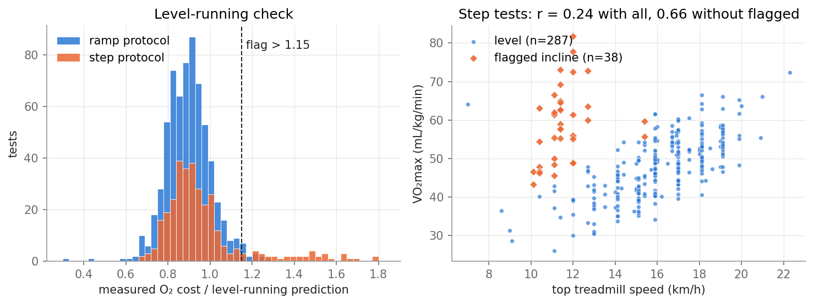
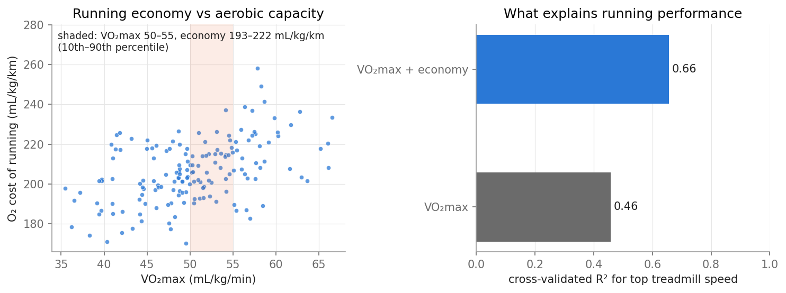
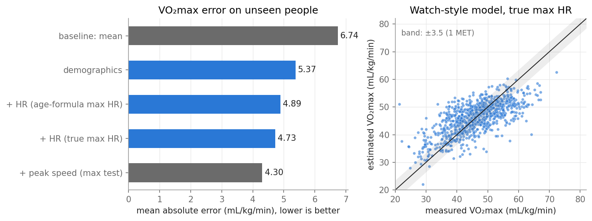

# Treadmill fitness insights

**From raw heart-rate, oxygen and speed data to feedback a runner can act on.**

A watch records heart rate and speed. Reporting raw numbers ("your heart rate was 162") is easy. Telling a
runner something useful ("you are fit but uneconomical; work on X") takes data analysis together with
physiology. This project practises that on 992 laboratory treadmill tests, using Python, pandas and
scikit-learn.

The full analysis, with code and figures, is in **[analysis.ipynb](analysis.ipynb)**.

## Findings

**1. A hidden confound: 51 tests were run on an incline the dataset does not record.**
- **The check:** on a level treadmill, oxygen cost is set by speed, and the ACSM running equation predicts
  it. The ratio of measured to predicted cost exposes a separate group of tests that need 1.3–1.8× more
  oxygen than their speed explains.
- **The effect:** these tests make "slow but very fit" runners appear. Removing them raises the
  correlation between top speed and VO₂max in step tests from 0.24 to 0.66.



**2. Running economy matters as much as aerobic capacity.**
- **Spread:** runners with the same VO₂max (50–55 mL/kg/min) differ by about ±7 % in the oxygen they need
  per km. At 5:00 min/km, that is the difference between running at 74 % and at 85 % of capacity.
- **Performance:** VO₂max alone explains 46 % of the variation in top treadmill speed (cross-validated
  R²). Together with economy it explains 66 %.



**3. Estimating VO₂max from watch-type data.** The models use heart rate at known speeds, age, sex and body
size. They are cross-validated with folds grouped by participant, so they are always tested on people
they have not seen.

| Information used | Mean absolute error (mL/kg/min) |
|---|---|
| guess the mean | 6.7 |
| age, sex, body size | 5.4 |
| + heart rate vs speed (max HR from the age formula) | 4.9 |
| + heart rate vs speed (runner's true max HR) | 4.7 |
| + top speed from a maximal test (reference) | 4.3 |

- **True max heart rate:** knowing the runner's own max heart rate beats the age formula, which misses by
  about 7 bpm on average.
- **Regression to the mean:** the model overestimates unfit and underestimates very fit people. A product
  would need calibration from many runs per person, not one session.



**4. Numbers into feedback.** The notebook ends by turning one runner's results into plain-language
messages. For example: *"Your VO₂max is higher than 70 % of runners here, but your economy is in the bottom
2 %: at 5:00 min/km you use 88 % of your capacity. Technique and strength work are your quickest route to
faster races."*

## Run it

```bash
pip install -r requirements.txt
python3 download_data.py                 # about 23 MB from PhysioNet into data/
jupyter lab analysis.ipynb               # or: jupyter nbconvert --execute --to notebook analysis.ipynb
python3 -m pytest tests                  # unit tests on synthetic data, no download needed
```

The feature extraction takes about a minute on a laptop.

## Code

| File | Content |
|---|---|
| `fitness/data.py` | loading; sets implausible sensor values to NaN; splits each test into exercise and recovery |
| `fitness/features.py` | per-test features: VO₂max, max HR, walking HR, speed at a given % of max HR, running economy, level-running check |
| `fitness/models.py` | ridge regression of feature sets with participant-grouped cross-validation |
| `tests/` | tests on synthetic exercise tests with known answers; run by GitHub Actions |
| `analysis.ipynb` | the analysis, findings and limitations |

**Design choices**
- **Read, don't extrapolate:** speed at a given heart rate is read directly from the data. An earlier
  version extrapolated a linear heart-rate–speed fit to max heart rate. That turned out to be unstable,
  and the feature lost almost all its correlation with VO₂max.
- **Steady stages only for economy:** running economy uses only 60-s stages, below RER 1, at 9–13 km/h.
- **Grouped cross-validation:** folds are grouped by participant, because some people were tested several
  times.

## Data

Mongin D, García Romero J, Alvero Cruz JR. *Treadmill Maximal Exercise Tests from the Exercise Physiology and
Human Performance Lab of the University of Malaga* (version 1.0.1). PhysioNet, 2021.
https://physionet.org/content/treadmill-exercise-cardioresp/1.0.1/

There are 992 tests from 857 participants aged 10–63, mostly male amateur and professional athletes. The
measurements are breath by breath, with heart rate from a 12-lead ECG. The data are licensed CC BY-NC-SA
4.0, so they are downloaded by the script rather than included here.

## Limitations

- The data are lab tests, not wrist-watch recordings.
- Incline is inferred, not recorded.
- 60-s stages are close to, but not fully at, a steady state.
- The sample is 85 % male.
- The feedback text illustrates the idea and is not coaching or medical advice.

The notebook discusses each point.

## License

- **Code:** MIT (see `LICENSE`).
- **Figures in `figures/`:** derived from the dataset, so they are shared under CC BY-NC-SA 4.0.
